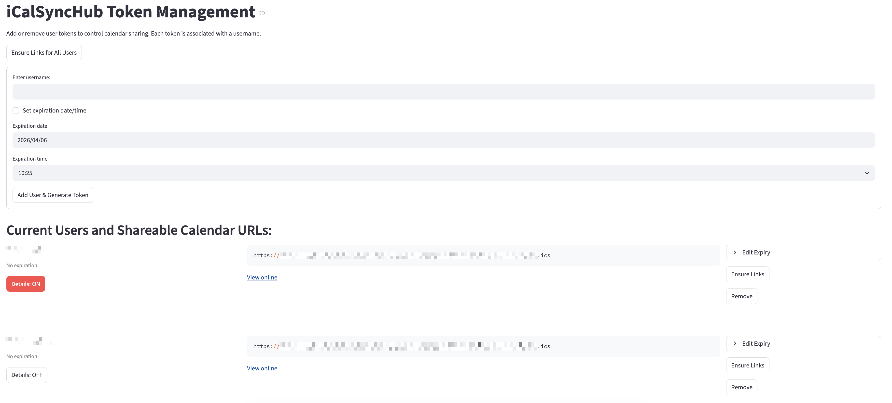

# iCalSyncHub

iCalSyncHub is a lightweight Python tool with a Streamlit web interface that merges multiple online iCal calendars into a single `.ics` file, which can be hosted on a web server. Users (tokens) can be added, managed, and expired through the web UI. Designed for simplicity and automation, it periodically updates the merged calendar at a configurable interval.

## Features
- **Multi-Calendar Support**: Combine events from two or more iCal calendars into one.
- **Automatic Syncing**: Automatically updates the merged calendar at a specified interval.
- **Date Range Filtering**: Optionally filter events to keep only a configurable time window (e.g., past 14 days and next 2 months).
- **Custom Configuration**: Use a simple `.ini` file to configure calendar URLs, output location, sync frequency, and more.
- **Portable Output**: Generates a standard `.ics` file compatible with popular calendar apps like Google Calendar, Outlook, and Apple Calendar.
- **HTML Calendar Viewer**: Each token automatically generates a shareable, responsive HTML viewer page (agenda list on phones, week view on desktop, light/dark theme, event details, subscribe actions) powered by FullCalendar, so users can view events in a browser without importing the ICS. See [HTML viewer](#html-viewer).
- **Per-User Detail Control**: Each user token can independently be set to **No details** (only Busy/Free), **Title only** (event title and time, nothing else) or **All details**, up to the level chosen globally with `show_details`. A companion ICS is generated for every lower level alongside the main file. See [Detail levels](#detail-levels).
- **Token Expiry**: Tokens can have an optional expiration date/time. Expired tokens are automatically cleaned up (symlinks and viewer pages removed) on UI refresh and at the start of each sync loop.
- **Settings Page**: A dedicated Streamlit page for editing every `config.ini` setting from the browser — output paths, sync schedule, event handling, logging, and the event colour map — and the calendar sources in `calendar_urls.txt`, with validation before anything is written. The comments in both files are preserved on save.
- **Raw Calendar Output**: Alongside the merged calendar, a `filename_raw` copy is written in which every event keeps its original `SUMMARY`, i.e. the per-URL custom summaries are not applied.
- **Sync Health Dashboard**: A dedicated Streamlit page showing per-source fetch status (success/failure, response time, event count), summary metrics, failure alerts, and sync history charts (duration, events, source status over time).
- **Error Handling**: Resilient to network errors or invalid calendar formats.

## Token Management

Tokens and their associated symlinks can be managed in several ways:

- **Manual Removal**: Remove a user/token at any time via the Streamlit app UI. The corresponding `.ics` symlink and `.html` viewer page are also removed.
- **Automatic Removal on Expiry**: When a token expires, its `.ics` symlink and `.html` viewer page are automatically removed by the Streamlit app (on UI refresh). The `sync_calendars.py` script removes only the `.ics` symlink at the start of each sync loop.
- **Ensure Links**: Use the "Ensure Links" button per user, or "Ensure Links for All Users" to recreate missing `.ics` symlinks and `.html` viewer pages in bulk.

This ensures your output directory only contains links for active tokens.

## Installation


### Quick Installation

Run the provided installer script to set up a Python virtual environment and install all dependencies (including Streamlit):

```bash
bash install.sh
```

This will create a `.venv` directory and install all required packages. To activate the environment later, use:

```bash
source .venv/bin/activate
```

---

#### Manual Prerequisites (if not using install.sh)
- Python 3.6 or higher
- Required Python libraries:
  - `requests`
  - `icalendar`
  - `pytz`
  - `streamlit`

Install the dependencies manually using pip if needed:

```bash
pip install requests icalendar pytz streamlit
```


## Usage

### Run Streamlit App on Boot (Optional)

To automatically start the Streamlit app at system boot, you can add a line to your crontab using the @reboot directive. For example, as root:

```bash
@reboot cd /root/iCalSyncHub && /root/iCalSyncHub/.venv/bin/streamlit run streamlit_app.py --server.headless=true >> /root/iCalSyncHub/streamlit.log 2>&1
```

This will launch the Streamlit app in headless mode and log output to streamlit.log after every reboot. Make sure the virtual environment and dependencies are installed as root if you use this path.

### 1. Clone the repository:

```bash
git clone https://github.com/ramhee98/iCalSyncHub.git
cd iCalSyncHub
```

### 2. Configure the app:

If you used the installer, it creates a config file automatically:
install.sh will copy config_template.ini -> config.ini if config.ini is missing.
It will not overwrite an existing config.ini and will warn if the template is missing.

Or, to copy manually:
```bash
cp config_template.ini config.ini
```

```bash
nano config.ini
```

### 3. Add calendar URLs:

Create a `calendar_urls.txt` file in the project directory, listing the calendar URLs to sync (or add them later from the **Calendar sources** tab of the Streamlit Settings page):

```bash
https://example.com/calendar1.ics
https://example.com/calendar2.ics
```

Custom anonymized summary per-URL

You can specify a custom summary to use when events are anonymized (detail level **No details**) by adding a `#` followed immediately by the summary text to the URL line. Examples:

```bash
# URL with a custom summary (URL-encoded or plain text accepted)
https://example.com/calendar1.ics#Out%20of%20Office

# Space before '#' is allowed
https://example.com/calendar2.ics #Tenative

# No value provided -> defaults to "Busy"
https://example.com/calendar3.ics#
```

Notes:

- If the fragment is empty (i.e., `#` with no text), the default summary `Busy` is used.
- Spaces may be included directly or URL-encoded; the value will be URL-decoded before use.
- The fragment is removed for fetching the calendar.
- At the **No details** level the custom summary replaces the event title entirely (e.g., `Busy [Out of Office]`). At **Title only** and **All details** it is appended as a label to the original event title (e.g., `Team Meeting [Out of Office]`).

Custom event coloring in viewer

You can define event colors for the HTML viewer in two ways:

- Per-summary mapping in `config.ini` under `[colors]`. Keys should match the original event SUMMARY text (or the summary itself when details are shown) and map to a hex color (e.g., `Meeting = #06b6d4`). The viewer is injected with this mapping and uses it first.
- Per-event property in the ICS: set `X-COLOR` or `COLOR` on a VEVENT to specify its color. The viewer will fall back to this if no config mapping is found.

Priority order: config `[colors]` mapping → `X-COLOR` / `COLOR` VEVENT property → calendar default styling.

The `[colors]` lookup tries the original summary (`X-ORIG-SUMMARY`, else `SUMMARY`), its lowercase form, then the trailing `[label]` and its lowercase form. `config.ini` keys are read in lowercase, so `Vacation = #f97316` also matches an event called "Vacation". Anything the browser does not accept as a CSS color is ignored.

### HTML viewer

`viewer_template.html` is a single self-contained page. The Streamlit app copies it to `<output_path>/<token>.html` and fills in two placeholders, `<!--INJECT_EVENT_COLOR_MAP-->` (the `[colors]` map) and `<!--INJECT_DEBUG_MODE-->` (always disables the debug panel). The page loads `<token>.ics` from the same directory, so there is no backend and nothing to build.

What the viewer offers:

- **Views**: agenda list (default below 768 px) and week view (default above), plus day and month. The view switches automatically when the window is resized until the user picks one.
- **Event details**: clicking or pressing Enter/Space on an event opens a dialog (a bottom sheet on phones) with the date and time range, location, description (links are clickable, nothing is rendered as HTML) and the source label. What it shows follows the detail level of the file: events from a **Title only** file have no description or location to show, and anonymized events (`Busy`/`Free`, optionally `[label]`) only show the time and the label.
- **Header**: calendar name (`X-WR-CALNAME` if present), last-updated time (the `Last-Modified` header of the ICS, else the newest `DTSTAMP`/`LAST-MODIFIED`), and a **Subscribe** menu with *copy ICS URL*, a `webcal://` link and *add to Google Calendar*. Google can only subscribe to publicly reachable URLs, and the link hands the secret ICS URL to Google, so it only happens when the user clicks it.
- **Legend**: one entry for every `[colors]` entry that matches at least one event.
- **Theme**: follows the OS (`prefers-color-scheme`) with a manual auto/light/dark toggle. The manual choice is stored in the browser's `localStorage` only.
- **All-day events** appear in the all-day row; multi-day all-day events span the days.
- **Accessibility**: keyboard navigation, visible focus, ARIA labels, and contrast of at least 4.5:1 in both themes (checked with axe-core).
- **Language**: German (de-CH), 24-hour times, Monday first. Every text lives in the `STRINGS` object at the top of the script, so translating means editing that one object (and `LOCALE`).

Parsing behaviour:

- ICS text is first cleaned by `normalizeIcs()` (broken `TZID` values, AM/PM times, folded lines) and parsed with ical.js; if that fails, the raw text is parsed instead.
- Recurring events are expanded from 180 days before to 365 days after today, honouring `EXDATE`, `RDATE` and `RECURRENCE-ID` overrides, with at most 730 occurrences inside that window per event.
- Events without a start, events that fail to parse and timed events with zero duration are skipped.
- When the template is opened without the Python injection (`window.ICS_DEBUG` undefined), a notice shows how many events were skipped, with details and a JSON download. Deployed viewers never show it.

Privacy: no analytics or trackers, and the calendar data stays in the browser. The page loads FullCalendar 6.1.22 and ical.js 1.4.0 from jsDelivr with pinned versions and Subresource Integrity hashes. It sets `noindex` and `no-referrer`, so the secret URL is neither indexed nor leaked through the `Referer` header when a description link is opened.

The viewer is copied per token, so after changing `viewer_template.html` or the `[colors]` section, use **Ensure Links for All Users** to regenerate the existing `.html` files.

Example VEVENT snippet with `X-COLOR`:

```ics
BEGIN:VEVENT
SUMMARY:Team Meeting
DTSTART:20260120T090000Z
DTEND:20260120T100000Z
X-COLOR:#06b6d4
END:VEVENT
```

### Detail levels

How much of each event is shared is controlled at two levels:

| Level | Settings / token page label | What the ICS contains |
|---|---|---|
| `none` | No details | Only availability: every event is titled `Busy` or `Free` (from `TRANSP`), plus the per-URL label if any. Timing and recurrence are kept. |
| `title` | Title only | The event title (plus label), time and recurrence. Description, location, attendees, organizer, URL, attachments, categories, conference links, alarms and every other field are removed. |
| `all` | All details | The complete event. |

- **Global** (`show_details` in `config.ini`, or *Settings → Events → Event detail level*): the most detail that is written at all. The main calendar file holds this level, and every lower level gets a companion file next to it, `<filename>_title.ics` and `<filename>_anon.ics`. A companion for a level at or above the global one is not written, and a leftover one is deleted, so lowering the level never leaves a more detailed file on disk.
- **Per user** (the **Details** selector on the token page): that user's `.ics` link points at the file for their level. A user can never get more than the global level, so with a global `title` a user stored as `all` is served the title-level file. The selector is hidden while the global level is `none`. New users start at `none`.

The files for the lower levels are written by the sync. If a user is switched to **Title only** before a sync running this version has written `<filename>_title.ics` (for example right after upgrading), the token page builds that file from the main file straight away while the global level is `all`. If a file cannot be made, the user's link serves the nearest lower level that exists until the next sync, and the page says so; a link never points at a missing file. Restart a long-running `sync_calendars.py` after upgrading, because a running process keeps using the old code and would never write `_title.ics`.

Below `all`, events are reduced with a whitelist: only the timing, recurrence, status, transparency, UID and colour properties survive, along with the title at `title` level. Fields a calendar server adds that this tool does not know about are dropped rather than passed through.

`user_tokens.txt` stores the level as the last field (`username:token:expiration:none|title|all`). Files with the older `true`/`false` are read as before and rewritten with the new names the next time a token changes.

### 4. Run the calendar sync:

```bash
python sync_calendars.py
```

The program will fetch the specified calendars, merge their events, and save the result as an iCal file at the configured location. It will then periodically sync the calendars based on the specified interval.


### 5. Manage user tokens and sharing (Streamlit app):


You can manage user tokens and generate shareable calendar links using the included Streamlit app:

```bash
source .venv/bin/activate  # if using a virtual environment
streamlit run streamlit_app.py
```

By default, the Streamlit app will be available at [http://localhost:8501](http://localhost:8501) (or `http://<your-server-ip>:8501` for remote access). You can change the port with `--server.port <port>` if needed.




#### Features of the Streamlit app:
- Add/remove users, each with a unique token. Usernames must be unique and cannot contain `:`, which separates the fields in `user_tokens.txt`.
- For each token, a public `.ics` link is generated (e.g., `https://yourdomain.com/<token>.ics`).
- The app automatically creates a symlink for each token in the output directory (e.g., `/var/www/html/<token>.ics`), pointing to the merged calendar file. This makes each link immediately accessible and shareable. Additionally, a static HTML viewer is created as `/var/www/html/<token>.html` so users can view the calendar online without importing the ICS.
- Tokens can have an optional expiration date/time. Expired tokens are marked in the UI and their symlinks and viewer pages are automatically removed.
- You can edit, add, or remove the expiry date for any token directly in the Streamlit app UI. When an expiry is set or changed to a future date, or removed (no expiry), the symlink is automatically recreated if it was previously removed due to expiry.
- The UI displays the expiry status for each token (e.g., EXPIRED, EXPIRES TODAY, EXPIRES SOON, or active).
- **Per-user detail level**: Unless `show_details` is `none`, each user has a **Details** selector (No details / Title only / All details), limited to the global level. The user's `.ics` symlink is switched to the matching file straight away. See [Detail levels](#detail-levels).
- **Share button**: Each token card shows a **Share** button next to the "View online" link. On mobile (HTTPS), it triggers the native OS share sheet (WhatsApp, Messages, etc.). On local/non-HTTPS connections it opens an inline menu with WhatsApp, Telegram, Email, and Copy link options. Dark mode is fully supported.
- **Ensure Links for All Users**: A bulk button recreates all missing `.ics` symlinks and `.html` viewer pages in one step.
- **Settings** (separate page): Edit the whole of `config.ini` — output directory, domain, calendar filenames, sync interval and retry behaviour, detail and date-range options, logging, and the `[colors]` map — from the browser. The **Calendar sources** tab edits `calendar_urls.txt`: add, remove or relabel calendars, or untick **On** to keep a source in the file without syncing it (it is written as a commented-out `#<url>` line, as you would do by hand). Each source keeps its `# Name` heading line, and the URLs are validated (`http(s)://`, no spaces or `#`, no duplicates). The sync re-reads the file on every cycle, so changes apply on the next one. Calendar URLs often embed a secret key, so keep the Streamlit app behind authentication. Input is validated before saving (for example, the raw calendar filename may not collide with the merged or anonymized file), comments in `config.ini` are kept intact, and settings the page does not expose are left untouched. Changes are picked up on the next sync cycle.
- **Sync Health Dashboard** (second page): Displays per-source fetch status (green/red indicators, response time, event count, errors), summary metrics (last sync time, duration, total events, OK/failed sources), failure alerts, and sync history charts with tabs for duration, event count, and source status over time. Data is recorded automatically in `sync_status.json` after each sync cycle.
- All token creation, deletion, and expiry/detail changes are logged to the main log file, including username, token, and relevant details.

**Note:**
- All token-based `.ics` links point to the merged calendar file for users at the global detail level; users at a lower level are routed to that level's companion file (`<filename>_title.ics`, `<filename>_anon.ics`).

### Automation of Expired Token Cleanup

`.ics` symlinks for expired tokens are automatically removed both by the Streamlit app (on UI refresh) and by the `sync_calendars.py` script (at the start of each sync loop). The `.html` viewer page is only removed by the Streamlit app. This ensures your output directory only contains active links, even if the Streamlit app is not running.

#### Security Considerations:
- The Streamlit app does not require authentication by default. Anyone with access can manage tokens. Protect access as needed.
- Tokens can have an expiration date. Remove or expire tokens to revoke access.

---

### Configuration Options

The `config.ini` file contains the following settings:

- **`output_path`**: Path where the merged calendar file will be saved.
- **`filename`**: Optional. Predefined filename for the output calendar. If not set, a random filename will be generated.
- **`filename_raw`**: Optional. Filename for a second copy of the merged calendar in which every event keeps its original `SUMMARY` — the per-URL custom summaries from `calendar_urls.txt` are not applied. Written to the same directory as `filename` on every sync. If not set, a random filename will be generated.
- **`domain`**: The public-facing domain used to build shareable calendar URLs (e.g., `https://yourdomain.com`). Used by the Streamlit app to display `.ics` and `.html` links.
- **`sync_interval`**: Time interval (in seconds) between calendar syncs. Set to `0` to sync only once.
- **`retries`**: Number of retry attempts if fetching a calendar fails.
- **`delay`**: Time in seconds to wait between retry attempts.
- **`timeout`**: Maximum time in seconds to wait for a response from a calendar URL.
- **`show_details`**: The highest level of detail that is written, one of `all`, `title` or `none` (also editable on the Settings page). The older `true` (= `all`) and `false` (= `none`) still work. An unrecognised value is treated as `none` and logged as a warning. See [Detail levels](#detail-levels).
- **`filter_by_date`**: Boolean. Set to `true` to enable date range filtering for events. When enabled, only events within the specified time window will be included in the merged calendar. Default is `false`.
- **`past_days`**: Number of days in the past to include when `filter_by_date` is enabled. For example, `14` includes events from the past 14 days. Default is `14`.
- **`future_months`**: Number of months in the future to include when `filter_by_date` is enabled. For example, `2` includes events up to 2 months ahead (approximately 60 days). Default is `2`.
- **`log_output`**: Specify where logs should be sent. Options are:
  - `console`: Logs are displayed only on the console.
  - `file`: Logs are saved only to the specified file.
  - `both`: Logs are sent to both the console and the file (default).
  - `none`: Disable logging entirely.
- **`log_level`**: Logging level to control the verbosity of the output. Options are `DEBUG`, `INFO`, `WARNING`, `ERROR`, and `CRITICAL`. Default is `INFO`.
- **`log_file`**: File path for the log output. Default is `icalsynchub.log`. Logs will be rotated if a file path is provided.
- **`max_log_file_size`**: Maximum size of a single log file in MB before rotation. Default is `10`.
- **`log_backup_count`**: Number of backup log files to keep after rotation. Default is `5`.

The `[colors]` section allows optional per-summary event color mappings for the HTML viewer:

```ini
[colors]
Vacation = #f97316
Meeting = #06b6d4
```


### Example Configuration File (`config.ini`)

```ini
[settings]
output_path = /var/www/html/
filename = mycal.ics
filename_raw = mycal_raw.ics
domain = https://yourdomain.com
sync_interval = 300
retries = 3
delay = 5
timeout = 10
show_details = all
filter_by_date = false
past_days = 14
future_months = 2
log_output = both
log_level = INFO
log_file = icalsynchub.log
max_log_file_size = 10
log_backup_count = 5

[colors]
#Vacation = #f97316
#Meeting = #06b6d4
```

## License

This project is licensed under the MIT License - see the [LICENSE](LICENSE) file for details.

## Contributing

Contributions are welcome! If you find a bug or have an idea for improvement, feel free to open an issue or submit a pull request.

## Acknowledgments

- Built using the [icalendar](https://icalendar.readthedocs.io/en/latest/) library.
- Inspired by the need for seamless calendar management.